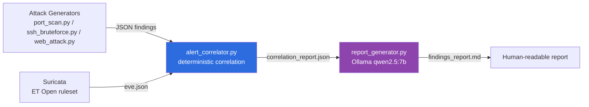

# AI-Assisted Network Intrusion Detection (DMZ-IDS)


Project 3 in a portfolio of AI-assisted networking projects. Related repos:
[network-compliance-auditor](https://github.com/omersalih-infra/network-compliance-auditor) ·
[network-anomaly-detector](https://github.com/omersalih-infra/network-anomaly-detector)

A DMZ-segmented GNS3 lab (edge router, FortiGate firewall, internal 3-VLAN
core, and a DMZ web server running Suricata/ET Open) is used to test whether
a deterministic correlation layer plus a locally-hosted LLM can reliably
detect and report on real attack traffic. The LLM is strictly
non-authoritative: it only explains and prioritizes findings that a
deterministic correlator (`alert_correlator.py`) has already computed; it
never decides what counts as "detected."

## Architecture



1. **Attack generators** write structured JSON findings to `results/`,
   timestamped for later correlation.
2. **Detection** — Suricata monitors the DMZ-facing interface and logs to
   `eve.json`.
3. **Deterministic correlation** matches each attack's timestamp window
   against Suricata alerts. No LLM involved at this stage.
4. **AI reporting** turns the correlation report into a prioritized,
   plain-language markdown write-up — never a re-decision of what was
   detected.

## Key finding

| Attack type | Alerts triggered | Result |
|---|---|---|
| Nmap port scan | ✅ 1/1 | Detected (ET SCAN signature) |
| SSH brute-force (Hydra) | ❌ 0/3 | Not detected — no signature match |
| SQLi / path traversal | ❌ 0/9 | Not detected — app-specific signatures, bare nginx has no backend |

Only the Nmap port scan reliably triggered a default ET Open alert.
SSH brute-force and generic SQLi/path-traversal payloads did not match any
active signature against a bare nginx server with no backend application --
ET Open's active SQLi rules are product-specific, not generic-syntax
matches, so this is an honest characteristic of the detection setup rather
than a bug. See
[`results/findings_report_20260720T204253Z_corrected.md`](results/findings_report_20260720T204253Z_corrected.md)
for the full write-up.

## Repo contents

- `port_scan.py`, `ssh_bruteforce.py`, `web_attack.py` — attack generators
- `alert_correlator.py` — deterministic detection/correlation layer
- `report_generator.py` — LLM reporting layer (Ollama / qwen2.5:7b)
- `results/` — sample output: one correlation report, one findings report,
  and a small extract of the Suricata alert log (`suricata_eve_sample.json`,
  alert-worthy events only, not the full raw capture)

Raw full-capture Suricata logs and raw device config dumps are intentionally
excluded; only this tooling's own structured JSON/markdown output is kept as
sample data.

## Requirements

- Python 3 with the packages in `requirements.txt`
- `nmap` and `hydra` CLI tools installed and on `PATH`
- [Ollama](https://ollama.com) running locally with `qwen2.5:7b` pulled
  (`ollama pull qwen2.5:7b`), for `report_generator.py` only
- A lab target running Suricata with the ET Open ruleset

## Usage

```bash
pip install --break-system-packages -r requirements.txt

python3 port_scan.py --target <DMZ-web-ip>
python3 ssh_bruteforce.py --target <DMZ-web-ip>
python3 web_attack.py --target <DMZ-web-ip>

python3 alert_correlator.py --eve-log <path-to-eve.json>
python3 report_generator.py --report results/correlation_report_<timestamp>.json
```

## Note

This project shares the AI-Server infrastructure (Ollama/qwen2.5:7b) used by
the other projects in this portfolio; it is not concurrently live across all
of them.
